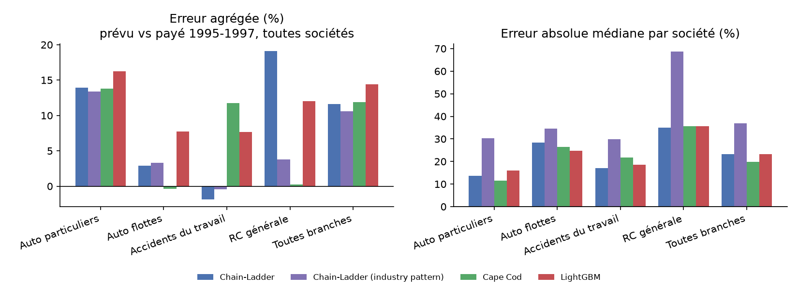
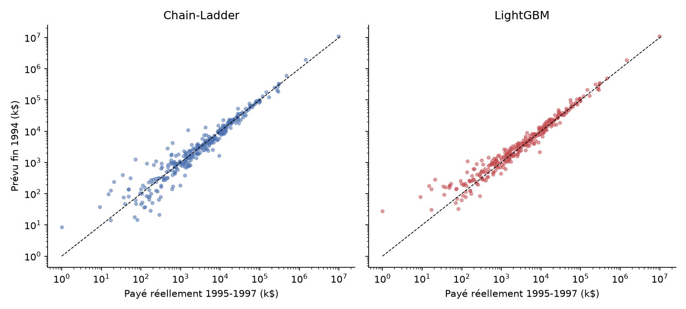
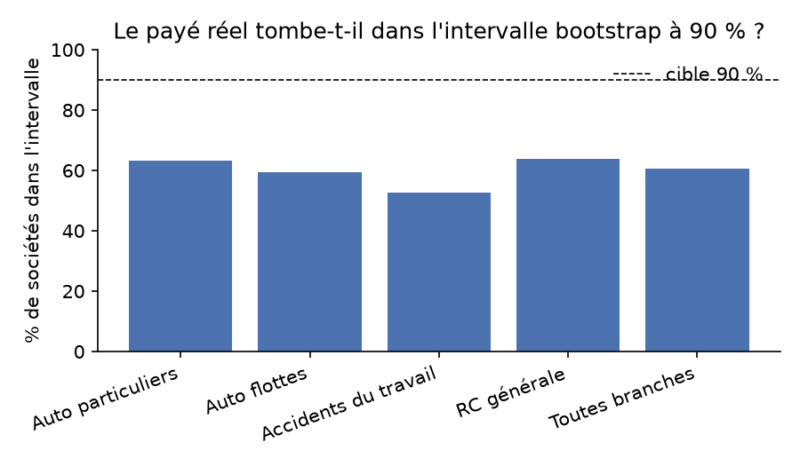

# IBNR reserving lab: Chain-Ladder, Cape Cod and LightGBM on a real backtest

**Question:** using only the paid-claims triangles known at the end of 1994, how well does each method predict the payments that were **actually made** in 1995–1997?

This is a backtest on the past rather than an estimate of reserves to ultimate: we hide the last 3 calendar diagonals of each triangle, predict them, and compare the predictions with what was really paid.



## Data
The **CAS Schedule P loss-reserve database** (public, compiled by the Casualty Actuarial Society), loaded with `chainladder.load_sample("clrd")`.
- Triangles of **net cumulative paid losses** and **net earned premium** (thousands USD) for US insurers, accident years 1988–1997 × 10 development years.
- 4 lines: private passenger auto (`ppauto`), commercial auto (`comauto`), workers' compensation (`wkcomp`) and other liability (`othliab`).
- **Quality filter:** we keep only complete triangles (no missing cells, premium > 0, payments > 0 in development year 1). **328 books are kept out of 671**; the exclusions are listed with their reason in `reports/excluded_books.csv`. Without this filter, a single company with a gap-filled triangle (Scpie Indemnity, other liability) was producing a Chain-Ladder prediction of 948k$ against 521$ actually paid, which on its own accounted for 80% of the method's total error.

## Methods
| Method | Idea |
|---|---|
| **Chain-Ladder** | The company's own volume-weighted development factors |
| **Chain-Ladder (industry pattern)** | Factors pooled over all companies in the line |
| **Cape Cod** | Bornhuetter-Ferguson with an expected loss ratio estimated from premium (more stable on young years) |
| **LightGBM** | A one-year-ahead model applied recursively for 3 years. Features: development year, line, ratio paid to date / premium, last increment, size, and the Chain-Ladder prediction (own and industry) as an input |
| **ODP bootstrap** | 500 resamples of the Chain-Ladder residuals plus Gamma process variance → a 90% interval per company |

**No look-ahead:** LightGBM is trained only on pseudo cut-offs *inside* the pre-1995 history (1990–1993). Its design (direct vs recursive) was chosen on a **separate validation cut-off** (end 1992 → 1993–94), not on the test:

| Validation 1993–94 | Aggregate error | Median error per company |
|---|---|---|
| Chain-Ladder | −0.4% | 21.0% |
| Cape Cod | +1.5% | 20.0% |
| LightGBM, direct (one model per 3-year horizon) | +24.2% | 30.1% |
| **LightGBM, recursive (1 year at a time)**, kept | +10.3% | 21.9% |

The direct design had only ever seen young development years for long horizons, so it extrapolated poorly for mature years.

## Results: test 1995–1997 (`python src/pipeline.py`)
Aggregate error = (Σ predicted / Σ paid − 1). The per-company median = the median of |predicted − paid| / paid.

| Line (books) | Chain-Ladder | CL industry | Cape Cod | LightGBM |
|---|---|---|---|---|
| Private auto (87) | +13.9% / 13.7% | +13.4% / 30.3% | +13.8% / **11.5%** | +16.2% / 16.1% |
| Commercial auto (86) | +2.9% / 28.5% | +3.3% / 34.7% | **−0.3%** / 26.5% | +7.7% / **24.8%** |
| Workers' comp (58) | **−1.8%** / **17.1%** | −0.4% / 29.9% | +11.8% / 21.8% | +7.7% / 18.6% |
| Other liability (97) | +19.1% / **35.0%** | +3.8% / 68.8% | **+0.3%** / 35.7% | +12.0% / 35.5% |
| **All (328)** | +11.6% / 23.2% | +10.6% / 36.8% | +11.9% / **19.8%** | +14.4% / 23.3% |

*(aggregate error / median error per company)*



## What we learn
1. **Cape Cod is the most robust.** It has the best median error overall (19.8%), and it's the only method that isn't thrown off on other liability (+0.3% in aggregate against +19.1% for Chain-Ladder). Anchoring on premium protects the small, volatile books.
2. **The industry pattern is fine in aggregate but bad company by company** (median 37%): each insurer has its own payment speed.
3. **LightGBM doesn't beat the classical methods.** Once the design flaw is fixed, it gets close to Chain-Ladder (23.3% median vs 23.2%) and is slightly better on commercial auto and workers' comp, but it doesn't beat Cape Cod. With only 10×10 triangles, there's little signal left to learn beyond the development factors.
4. **Every method over-predicts 1995–1997 (by about 11–14%)**, even though Chain-Ladder was almost unbiased on 1993–94. This suggests a **calendar-year effect**: payments slower than the historical pattern, which no model fitted on the past can anticipate.
5. **That's also why the bootstrap intervals are too narrow:** what was actually paid falls inside the 90% interval for only **60.6%** of books (325 books; the bootstrap is undefined for 3). The ODP bootstrap captures parameter and process uncertainty, but not a change of regime.



## Limitations
- US data from 1988–1997, with no tail beyond 10 years; the backtest only covers the next 3 calendar years.
- The quality filter removes half the books, mostly the smallest and most irregular ones.
- LightGBM hyperparameters were fixed a priori, with no search.

## Possible extensions on a real portfolio
On an insurer's or a takaful operator's data: triangles by product and by quarter, incurred claims (paid + case reserves) as well as paid, a calendar-year adjustment (inflation, change in claims handling), and projection of the technical result and the surplus of the participants' fund from the projected claims.

## Reproduce
```bash
pip install -r requirements.txt
python src/pipeline.py     # backtest + bootstrap (~8 min)
python src/ml_design.py    # validation of the ML design (1992 cut-off)
python src/figures.py      # figures
```
Outputs are in `reports/`: `backtest_summary.csv`, `backtest_by_company.csv`, `bootstrap_coverage.csv`, `ml_design_validation.csv`, `excluded_books.csv`.
